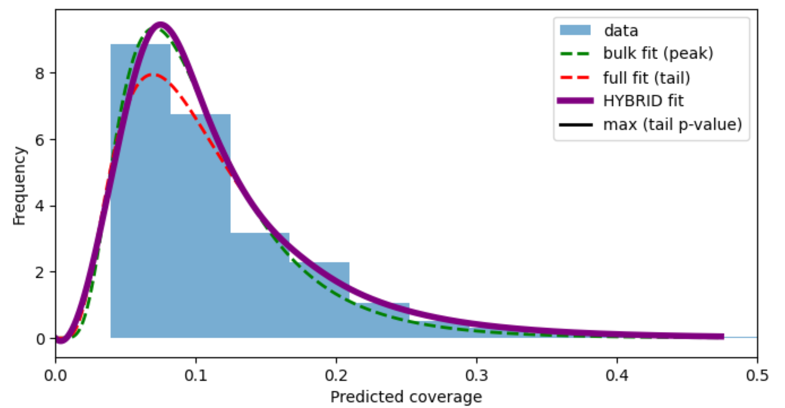

# Peak Calling HYPER whole-genome predicted tracks

Reconstructed transcription factor ChIP-seq tracks usually have a assimilate to
a lognormal distribution. This script fits two log-normals to the predicted signal.
One to the bulk, also referred to as **bulk fit**, (everything up to ``--bulk-quantile``), 
which describes background, and one to the whole distribution, also referred to as 
**full fit**,whose heavier tail describes real signal. Where the two densities cross 
is the split point: below it the bulk fit applies, above it the full fit does. Bins 
are then called as peaks if they are extreme under that model and also high enough 
relative to the background mean.



## Usage

To run the script both `run.sh` and `call_peaks.py` must be in the same folder.

**Basic run:**
```bash
python call_peaks.py signal.bw -o peaks.bed --plot fit.png
```

**Customised run:**
```bash
python call_peaks.py signal.bedGraph -o peaks.bed \
    --background 0.04 --model bulk \
    --chroms chr1 chr2 chr3 chr4 \
    --threshold-mode pvalue --pvalue 1e-4 \
    --merge-adjacent --bed6 \
    --plot fit.png
```
 
The input format is detected from the file itself, not from the extension.


**Recommentation:** Run the command with the default values initially. In order to better fit
the distribution to your data, you can move around parameters like background or model.


## Parameters

### Input
 
* `signal` *(positional, required)* — the track to call peaks on: a bigWig
  (`.bw`) or a 4-column bedGraph. The format is detected from the file's magic
  bytes, so the extension can be anything.
* `-o`, `--output` *(required)* — path of the BED file to write.
* `--chroms` *(default: all)* — restrict to these chromosomes, e.g.
  `--chroms chr1 chr2`. Useful for a quick test before a whole-genome run.
* `--bin-size` *(default: unset)* — re-bin a bigWig into fixed windows of this
  width. Leave it unset for a track that is already binned, since the stored
  intervals are then the bins. **Set it if the file came from
  `bedGraphToBigWig`**, which collapses runs of equal value into one wide
  interval: without re-binning, a long stretch of background counts once rather
  than once per bin, and the fitted distribution is skewed. The script warns if
  the intervals are not all the same width.

### Background and fitting
 
* `--background` *(default: `auto`)* — drop bins at or below this value before
  fitting, to remove a low population the model emitted where it saw nothing.
  `auto` fits a log-normal above a dozen candidate cuts and keeps the smallest
  one that fits the kept data best, reporting the KS distance it achieved. Set
  a number once you have one you trust for a track; it also skips the scan.
* `--model` *(default: `hybrid`)* — which model a bin is judged against:
  * `hybrid` — the bulk density below the split, the full density above it.
  * `bulk` — the bulk fit alone, everywhere.
  * `full` — the full fit alone, everywhere.
  Both fits, the split and the fold change are computed the same way in all
  three, so only the density a bin is scored against changes and the models can
  be compared on one track. In `pvalue` mode `hybrid` and `full` coincide by
  construction, since hybrid p-values come from the full fit.
* `--bulk-quantile` *(default: `auto`)* — the bulk fit uses values up to this
  quantile. `auto` picks the one whose fit matches the core best, by KS
  distance. Set too high, the bulk fit swallows part of the signal tail, which
  widens it and drops its peak below the histogram.
* `--loc` *(default: `auto`)* — where the log-normal is allowed to start. A
  number pins it there; `zero` pins it at 0; `free` lets it float; `auto` tries
  both and keeps the better fit. A number must be ≥ 0 and below the smallest
  kept value, because the density would otherwise be zero where there is data.
  Under `hybrid` this applies to the bulk fit only — the tail fit stays pinned
  at zero, since a floating start fits the body slightly better but the tail
  worse, and the tail is what sets the p-values.
  To say *"everything below X is background"*, use `--background X`, not
  `--loc X`. `--loc` additionally forces the distribution to **begin** at X, and
  signal above a cut is the tail of a distribution that starts lower.

### Peak calling
 
* `--threshold-mode` *(default: `density`)* — `density` calls a bin when the
  model's density at its value falls below `--density-threshold`; `pvalue` uses
  the upper-tail survival function, which is an actual p-value.
* `--density-threshold` *(default: `1e-3`)* — used by `--threshold-mode density`.
* `--pvalue` *(default: `1e-4`)* — used by `--threshold-mode pvalue`.
* `--fold-change` *(default: `5.0`)* — a bin must also be at least this many
  times the background mean (the mean of the bins at or below the split). This
  is a second, independent filter: on a well-fitted track it is often the
  binding one, so lowering it is what lets the statistical threshold decide.

### Output
 
* `--merge-adjacent` — collapse runs of touching called bins into one peak,
  keeping the best score in the run. Without it, every called bin is its own
  BED line.
* `--bed6` — write 6 BED columns instead of 4.
* `--name-prefix` *(default: `peak`)* — prefix for the peak names.
* `--plot` — save a diagnostic plot of the fits (strongly recommended; it is
  the only way to see whether the model describes the track).
* `--plot-scale` *(default: `linear`)* — `linear` shows the log-normal shape of
  binned coverage directly; `log` suits a track spanning orders of magnitude.


## Output files


### The BED file
 
Peaks are sorted by score, best first, and named `<prefix>_1`, `<prefix>_2`, …
in that order.
 
Four columns by default:
 
```
chr1    70775000    70775200    peak_1
chr1    70775400    70775600    peak_2
```
 
Six with `--bed6`, adding the score and a placeholder strand:
 
```
chr1    70774600    70776000    peak_1    82.846    .
chr1    115049800   115051200   peak_2    77.175    .
```
 
The score is `-log10` of the statistic the bin was thresholded on — the model's
density in `density` mode, the tail probability in `pvalue` mode — so a larger
score is a stronger peak in both. The scores are **not** comparable between the
two modes.
 
### The plot
 
With `--plot`, a single panel: the histogram of the kept bins, the bulk fit
(green dashed), the full fit (red dashed), the split (dotted vertical) and the
model actually used for calling as a thick purple curve. Whichever `--model`
you pick, the others are still drawn, so one run shows what the other choices
would have given.
 
**Read the purple curve against the top of the histogram.** If it falls short of
the histogram's peak, the background is not being described properly and the
peak calls will be off: try a different `--background`, or `--bulk-quantile`.
 
### Terminal output
 
Every run prints what it decided, which is worth keeping with the results:
 
```
read 1,500,000 bins from track.bw (bigWig)
background cut: 0.04  (given)
kept 1,433,670 bins (95.6%)
bulk quantile: 0.980  (chosen by KS distance (0.0070))
model: hybrid
bulk  fit: shape 0.1914  loc 0.0000  scale 0.0740
full  fit: shape 0.2752  loc 0.0000  scale 0.0758
split at 0.09098 (quantile 0.8441 of the kept bins)
8,811 bins called (density threshold, fold change > 5.0)
merged 8,811 bins into 2,335 peaks
wrote 2,335 peaks -> demo.bed
plot -> demo.png
total 6.9s  (read 1.5s  fit 4.0s  call 0.2s  plot 1.3s)
```

## Requirements

* Python
* NumpPy
* Pandas
* SciPy
* PyBigWig
* MatPlotlib


